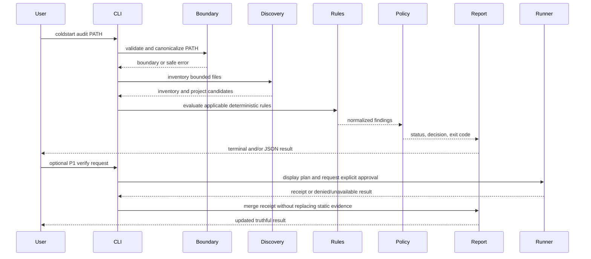

# ColdStart System Architecture

**Status:** P0 approved; M6.1 Docker-backed offline execution boundary implemented in a bounded slice
**Version:** 0.4
**Architectural target:** P0 deterministic static auditor with a P1 execution extension

## 1. System overview

ColdStart is a Python 3.12.8 command-line application. Its P0 core is a deterministic pipeline:

```text
CLI input → boundary validation → bounded discovery → project detection
→ applicability planning → static rules → evidence classification
→ fingerprint → normalized findings
→ policy/exit calculation → terminal or JSON report
```

The P1 verification layer is intentionally separate and is implemented first as a bounded broker:

```text
static report → proposed execution plan → explicit approval
→ constrained runner → execution receipt → merged report
```

The repository under audit is untrusted input. No P0 component may execute a project-derived command. The P1 runner is the only component permitted to launch a project process, and it is not available implicitly. The current runner accepts only direct Python `unittest`/`pytest` argv for the host path, a fixed Docker-isolated test wrapper for offline mode, or a fixed Docker build argv; shell recipes and arbitrary scripts are rejected.

## 2. Component diagram

```mermaid
flowchart LR
    U[User or CI] --> CLI[CLI phase and instructions]
    CLI --> CFG[Config loader]
    CLI --> BOUND[Boundary and filesystem safety]
    BOUND --> DISC[Repository discovery]
    DISC --> DETECT[Project and file-type detection]
    DETECT --> APPLY[Applicability planner]
    APPLY --> RULES[Deterministic audit rules]
    RULES --> EVID[Evidence and finding model]
    EVID --> POLICY[Policy and exit-code calculator]
    POLICY --> REPORT[Terminal and JSON serializers]
    REPORT --> OUT[stdout / explicit report path]
    APPLY -. P1 proposal .-> PLAN[Execution plan]
    PLAN --> AUTH[Explicit authorization]
    AUTH --> RUN[Execution broker]
    RUN --> DOCKER[Optional Docker runner]
    RUN --> RECEIPT[Execution receipt]
    RECEIPT --> EVID
    REPO[(Untrusted local repository)] --> BOUND
```



## 3. Request and data-flow diagram



## 4. Repository inspection sequence

1. Parse command-line arguments without shell interpolation.
2. Load and validate the optional ColdStart policy.
3. Resolve the supplied path without following external symlinks.
4. Display the boundary, exclusions, and limits.
5. Enumerate regular files in stable path order with count, byte, depth, and time limits.
6. Read only bounded text/config formats using non-executing parsers.
7. Detect Python and generic project signals.
8. Determine which checks apply and record the reason for every non-applicable check.
9. Run P0 rules in stable check-ID order.
10. Classify evidence strength and redact evidence.
11. Calculate the audit fingerprint from canonical bounded inputs.
12. Evaluate policy and exit code.
13. Render the requested output.

P0 never imports the target repository, runs `setup.py`, executes a package script, invokes a shell, installs dependencies, starts a service, or creates a repository staging copy.

## 5. Planned package and directory structure

This is an implementation target; it is not being created during the documentation phase.

```text
src/coldstart/
├── cli/                 # argument parsing, help, command phases
├── config/              # .coldstart.toml parsing and validation
├── boundary/            # path, symlink, limits, P1 temporary ownership
├── discovery/           # file inventory and project signals
├── checks/              # check registry, applicability, P0 rule functions
├── findings/            # evidence, statuses, severity, normalization
├── reporting/           # terminal and JSON serializers
├── policy/              # configured thresholds and exit code calculation
├── execution.py         # P1 plan, authorization, bounded broker, receipts
└── version.py           # tool, schema, and catalog versions
tests/
├── unit/
├── integration/
├── cli/
├── security/
├── contract/
└── fixtures/
```

## 6. Module responsibilities

| Module | Responsibility | Must not do |
| --- | --- | --- |
| `cli` | Parse and validate user intent, render help, select phases | Inspect project scripts directly or execute commands |
| `config` | Parse bounded policy and defaults | Read secrets or silently enable execution |
| `boundary` | Enforce root, symlink, size, time, and P1 temporary-dir rules | Decide whether a project is reproducible |
| `discovery` | Inventory files and project signals | Import or execute repository code |
| `checks` | Apply deterministic rule algorithms | Spawn processes or write the repository |
| `findings` | Normalize statuses, evidence, remediation, and provenance | Decide policy exit codes from raw strings |
| `reporting` | Serialize normalized data to terminal/JSON | Reclassify statuses or invent evidence |
| `policy` | Apply configured pass/fail/unknown rules and calculate exit code | Modify findings or hide unknowns |
| `execution` | P1 authorization and constrained process/container control | Run without an approved plan |
| `version` | Return stable tool/schema/catalog identifiers | Depend on repository input |

## 7. Module dependency rules

1. `checks` may depend on `discovery`, `boundary` data types, and `findings`; it may not depend on `cli`, `reporting`, or `execution`.
2. `reporting` depends on normalized findings and contract definitions; it may not parse repository files.
3. `policy` depends on findings and configuration; it may not read repository files.
4. `execution` depends on the plan, authorization, boundary/staging, and receipt types; it may not be invoked by a static rule. The CLI invokes it only for the distinct `verify` command after a plan is built.
5. `cli` is the composition root and may depend on all public interfaces, but it contains no rule algorithms.
6. No module imports the target repository as Python code.

## 8. Interfaces between modules

The implementation should use small typed data objects or protocols for:

- `RepositoryBoundary`: canonical root label, exclusions, limits, and symlink policy;
- `FileRecord`: relative path, kind, bounded size, digest/metadata, and read status;
- `ProjectCandidate`: ecosystem, confidence, evidence, and adapter coverage;
- `Applicability`: check ID, applicable/`not_applicable` state, reason, and adapter;
- `EvidenceStrength`: `direct`, `derived`, `indicator`, `absence`, or `unverified`;
- `Finding`: contract fields, evidence strength, and provenance;
- `AuditFingerprint`: canonical digest of bounded evidence, policy, tool version, and catalog version;
- `ExecutionPlan`: kind, safe argv/build request, working directory, network/resource limits, and risk notice;
- `ExecutionReceipt`: authorization, observed result, output truncation, cleanup, and manifest comparison;
- `AuditReport`: metadata, project, checks, policy, verification, redaction, and summary.

The core audit engine receives an immutable or treated-as-immutable snapshot of these inputs. Rendering and policy consume the normalized model rather than re-reading files.

## 9. Error propagation

- Expected input problems become documented CLI errors or findings.
- A single unreadable file or malformed manifest is isolated to the affected check.
- A boundary or configuration error stops the audit before project analysis.
- A resource-limit breach stops further discovery safely and marks coverage incomplete.
- An unexpected internal exception produces a sanitized internal-error result and exit code `4`; it cannot produce a pass.
- P1 runner failures become receipts and findings; they do not erase valid P0 results.

## 10. Logging behavior

P0 normal output is the report only. Diagnostic logs, when enabled, are local, bounded, redacted, and written to stderr or an explicit path outside the inspected repository. No telemetry exists in the first release. Project content is never logged wholesale.

## 11. Finding lifecycle

```text
rule definition → applicability decision → evidence collection
→ raw finding → redaction/normalization → policy evaluation
→ terminal/JSON serialization → optional execution merge
```

Every transition preserves the rule ID and status. Policy may change the process decision, but it may not turn `not_verified`, `skipped`, or `not_applicable` into `passed`.

## 12. Report-generation lifecycle

1. Build report metadata from tool/version/options.
2. Add project detection and applicability records.
3. Add findings in deterministic order.
4. Add policy and exit decision.
5. Add the audit fingerprint and verification state/receipts, if any.
6. Apply final redaction and path normalization.
7. Validate the in-memory contract.
8. Serialize terminal or JSON output.

## 13. Configuration model

The optional `.coldstart.toml` file controls policy, bounded limits, exclusions, output defaults, and P1 permissions. P1 profiles (`beginner`, `strict`, and `ci`) are named policy presets, not alternate rule engines. It does not contain credentials and cannot enable arbitrary shell execution. Invalid configuration fails closed before repository analysis. Command-line options override documented non-security display settings; security-sensitive execution settings require explicit confirmation.

## 14. Dependency and runtime strategy

The recommended P0 runtime uses Python 3.12.8 and the standard library for the audit core (`argparse`, `pathlib`, `tomllib`, `json`, `hashlib`, and `subprocess` only behind the P1 broker). Development tooling may use pinned `pytest` and `ruff`. A committed, hash-pinned dependency lockfile and a Dockerfile are release gates. The exact setup commands are specified in `docs/10_BUILD_AND_REPRODUCIBILITY.md`; the target-runtime and Docker gates remain unverified in the current workspace.

The design avoids a general plugin marketplace. New checks are ordinary reviewed modules registered in one check catalog until the MVP demonstrates a need for a more extensible interface. The implemented `explain` command reads bundled metadata keyed to that same catalog rather than introducing an AI explanation path.

## 15. Runtime compatibility

The static CLI targets pinned Python 3.12.8 on Linux, Windows, and macOS. The clean Linux build is the competition release baseline. Docker is optional for P0 and required only for the P1 verification path. Platform-specific filesystem differences are normalized and covered by tests rather than hidden.

## 16. Testability considerations

- Discovery and rules accept fixture data instead of global process state.
- Report serialization is contract-tested independently of rendering.
- The execution broker has bounded fixture tests for denial, plan-only behavior, authorization, Docker-backed offline plan safety, timeout, output, source-manifest comparison, sandbox validation, and Docker unavailability. Actual Docker image execution remains target-environment work.
- Security tests can substitute process and filesystem observers.
- Fixtures are deliberately clean, defective, malformed, large, symlinked, and secret-bearing.

## 17. Trade-offs

- Python is easier to develop and understand than a native single binary but requires a pinned runtime and packaging discipline.
- A standard-library-first core reduces dependency risk but limits parser sophistication; unsupported cases become honest unknowns.
- Docker-based verification is safer than host execution but is slower and may be unavailable; that is why it is P1.
- A small reviewed check registry is less extensible than a plugin framework but reduces attack surface and competition-schedule risk.
- A versioned JSON contract requires upfront design but prevents CI consumers from depending on terminal text.

## 18. Advanced improvement placement

The advanced roadmap is deliberately layered:

- P0 evidence strength, audit fingerprint, self-audit, and no static staging workspace strengthen trust without adding execution risk.
- P1 baseline/diff, rule explanation, policy profiles, and plan-only verification improve maintainability and usability after the core is stable.
- AI, hosted services, automatic changes, plugins, and universal language coverage remain out of scope because they add more complexity than user value for the competition MVP.
